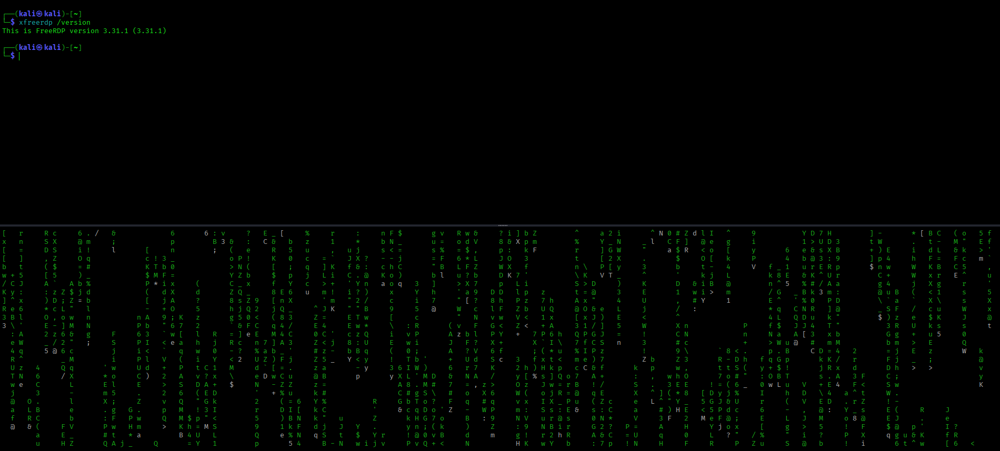
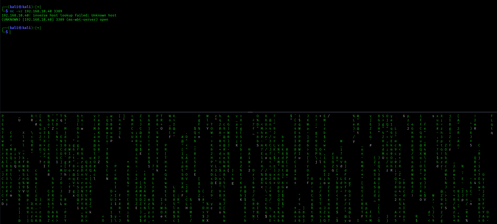
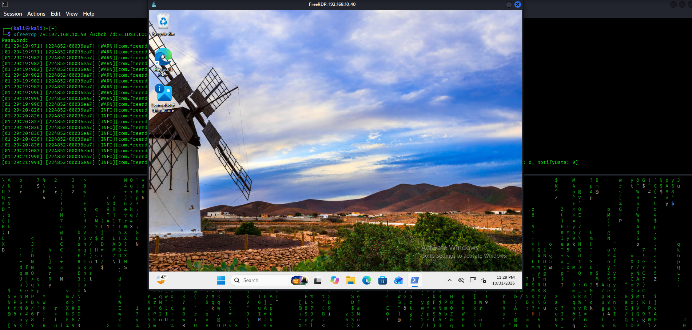
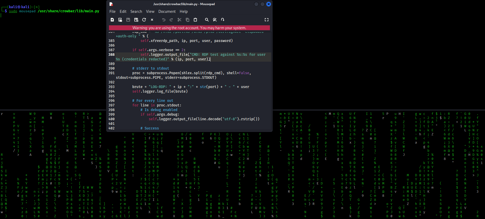
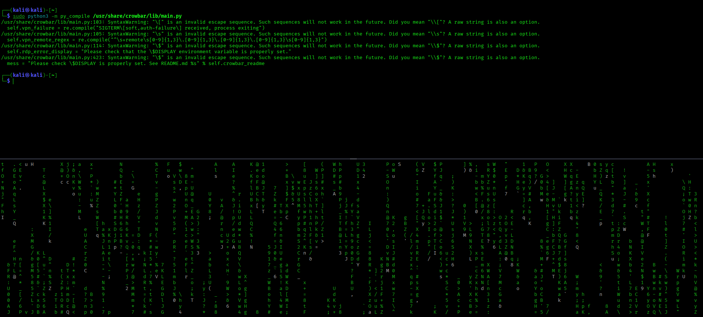

# RDP Authentication Troubleshooting & Crowbar Logging Hardening

Troubleshot RDP connectivity and authentication from Kali Linux to a Windows Active Directory lab, then inspected and modified Crowbar's logging to prevent passwords from being written to its RDP log entries.

## Project Overview

The goal of this project was to troubleshoot Remote Desktop Protocol (RDP) connectivity between Kali Linux and a Windows machine joined to an Active Directory domain. During testing, I also inspected Crowbar's Python source code and identified a credential-exposure issue in its RDP logging.

This project focused on network connectivity, DNS, Kerberos authentication, Windows RDP configuration, Linux command-line troubleshooting, and basic Python source-code review.

## Lab Environment

| System | Configuration |
|---|---|
| Kali Linux | Testing and troubleshooting workstation |
| Windows Server | Active Directory domain controller |
| Windows Client | Domain-joined RDP target |
| Domain | `guestdsi.local` |
| Domain Controller | `192.168.10.80` |
| RDP Target | `192.168.10.40` |

All systems were part of my isolated home lab.

## Tools Used

- Kali Linux
- Windows Server / Active Directory
- Windows Remote Desktop
- FreeRDP (`xfreerdp`)
- Crowbar
- Python 3
- `kinit`
- `dig`
- `nc` (Netcat)
- Mousepad text editor

## Troubleshooting Walkthrough

### 1. Verify RDP Network Connectivity

First, I checked whether the Windows target was reachable on TCP port 3389.

```bash
nc -vz 192.168.10.40 3389
```

The connection succeeded:

```text
(UNKNOWN) [192.168.10.40] 3389 (ms-wbt-server) open
```

This confirmed that the RDP port was accepting TCP connections. The reverse DNS lookup warning was not a connection failure.

### 2. Verify DNS and Kerberos

I configured Kali to use the domain controller as its DNS server:

```text
192.168.10.80
```

I then checked the domain's Kerberos and LDAP service records:

```bash
dig _kerberos._tcp.elidsi.local SRV
dig _ldap._tcp.elidsi.local SRV
```

I tested connectivity to the domain controller's Kerberos and LDAP ports:

```bash
nc -vz 192.168.10.80 88
nc -vz 192.168.10.80 389
```

Both ports were reachable.

Next, I requested a Kerberos ticket for the lab user:

```bash
kinit bob@ELIDSI.LOCAL
```

I verified that a ticket was issued:

```bash
klist
```

This confirmed that Kali could authenticate to the domain's Kerberos service and obtain a ticket.

### 3. Troubleshoot the FreeRDP Connection

My initial RDP testing exposed a difference between RDP security modes.

**Symptom:** Testing with `/sec:rdp` resulted in:

```text
ERRCONNECT_CONNECT_TRANSPORT_FAILED
```

The connection was reset by the remote host.

**Troubleshooting:** I tested a different RDP security mode and used FreeRDP's interactive password prompt instead of relying on a password supplied through a command-line argument.

**Resolution:** The connection succeeded using TLS:

```bash
xfreerdp /v:192.168.10.40 /u:bob /d:ELIDSI.LOCAL /cert:ignore /sec:tls /from-stdin:force
```

FreeRDP prompted for the password, and I successfully opened the Windows remote desktop session.

The `/cert:ignore` option bypasses certificate validation. I used it because this isolated lab uses a certificate that is not trusted by Kali. This is a lab-only workaround and is not appropriate for production environments.

### 4. Inspect and Improve Crowbar Logging

While reviewing Crowbar's Python source code, I found that its RDP logging statement included the password in the log entry.

**Original code:**

```python
brute = "LOG-RDP: " + ip + ":" + str(port) + " - " + user + ":" + password
self.logger.log_file(brute)
```

This could expose account passwords to anyone who could access the log file.

**Modified code:**

```python
brute = "LOG-RDP: " + ip + ":" + str(port) + " - " + user
self.logger.log_file(brute)
```

I also changed the verbose command logging so it no longer prints the full command containing the password.

**Modified verbose logging:**

```python
if self.args.verbose == 2:
    self.logger.output_file(
        "CMD: RDP test against %s:%s for user %s (credentials redacted)"
        % (ip, port, user)
    )
```

I created a backup before editing:

```bash
sudo cp /usr/share/crowbar/lib/main.py /usr/share/crowbar/lib/main.py.bak
```

These changes reduce the risk of passwords being exposed through Crowbar's RDP log output. They do not yet eliminate every possible credential-exposure path in Crowbar.

### 5. Validate the Python Changes

After editing the source file, I checked it for Python syntax and indentation errors:

```bash
sudo python3 -m py_compile /usr/share/crowbar/lib/main.py
```

The compilation completed without syntax or indentation errors. Python displayed some pre-existing SyntaxWarnings, which were separate from the edits.

## Challenges and Lessons Learned

| Symptom | Finding | Resolution |
|---|---|---|
| RDP connection failed using `/sec:rdp` | The connection was reset during transport setup | Tested TLS security mode, which successfully connected |
| Password was included in Crowbar's RDP log entry | The logging statement concatenated the password into the log string | Removed the password from the log entry |
| Initial FreeRDP password testing was inconclusive | The command did not actually prompt for a password | Used `/from-stdin:force` to enter credentials interactively |

## Screenshots

The screenshots below document the tools, troubleshooting process, successful connection, and source-code changes.











## Security Considerations

- Removed passwords from the RDP log-entry string.
- Redacted credentials from verbose RDP command logging.
- Created a backup of the original Crowbar source file before editing.
- Used an interactive password prompt for the successful FreeRDP test.
- Used `/cert:ignore` only in the isolated lab; production systems should validate trusted certificates.
- Other Crowbar modules may have separate credential-logging behavior and require their own review.

## Skills Demonstrated

- Linux command-line troubleshooting
- DNS and Kerberos service discovery
- TCP connectivity testing
- Active Directory authentication troubleshooting
- RDP and FreeRDP configuration
- Python source-code inspection and modification
- Credential-handling and log-security awareness
- Python syntax validation
- Technical documentation

## Next Steps

- Test RDP connectivity with another client to compare behavior.
- Review additional Crowbar logging paths for credential exposure.
- Investigate Crowbar's compatibility with the installed FreeRDP version.
- Build a reusable DNS, Kerberos, and RDP troubleshooting checklist.
- Document the final lab configuration and troubleshooting process.

## Takeaway

This project reinforced the importance of troubleshooting layer by layer: verifying network connectivity, checking DNS and Kerberos, testing RDP security settings, and inspecting application source code when behavior does not match expectations. It also demonstrated how seemingly small logging decisions can create security risks.
